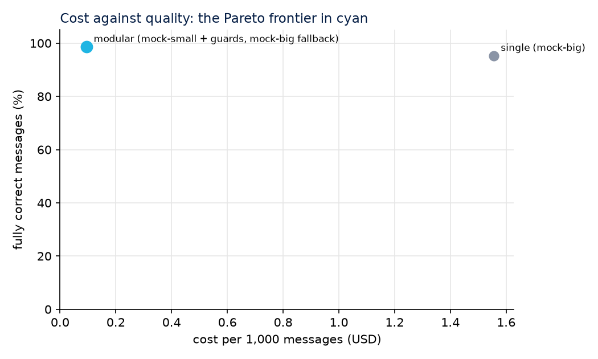

# llm-cost-quality-bench

**Medí cuánto cuesta un LLM y qué tan bien trabaja en una tarea de negocio real, antes de confiarle la tarea.**
Por [GlobalAIze](https://www.globalaize.com). Datos 100 % sintéticos. Corre sin API keys.

[](https://github.com/mauroemartinez/llm-cost-quality-bench/actions/workflows/ci.yml)
[](LICENSE)

[English version](README.md)

## El problema

Un agente de IA que contesta proveedores, lee cotizaciones o clasifica mensajes suele armarse una vez, con el modelo más grande disponible y un prompt largo, y queda corriendo. Dos cosas fallan en silencio:

- **Nadie sabe cuánto cuesta por tarea.** La factura llega por mes y por API key, no por mensaje. La caché de prompts, los reintentos y los tokens de razonamiento la vuelven difícil de leer.
- **Nadie sabe cada cuánto se equivoca.** "Se ve bien" no es un número. Cambiar a un modelo más barato es un salto al vacío, así que nadie lo hace.

Nosotros operamos agentes de IA para comercio internacional, donde cada mensaje a un proveedor importa. Antes de tocar producción necesitábamos responder con números: *qué costaría un modelo más barato o un diseño distinto, y qué rompería.*

## La solución

Este repositorio es ese método, abierto, sobre una tarea que cualquiera puede inspeccionar:

**La tarea.** Mensajes sintéticos de proveedores en una negociación de compras B2B: cotizaciones con precio, moneda, cantidad mínima, plazo de entrega, Incoterm y condiciones de pago, más respuestas a contraofertas, preguntas, rechazos y acuses de recibo. Cada mensaje viene con su respuesta correcta conocida. La IA tiene que **extraer** las condiciones, **clasificar** la intención y **redactar** nuestra respuesta. Los mensajes traen el ruido de los reales: un Incoterm alternativo ofrecido al lado del precio real, un precio corregido dentro del mismo mensaje, rangos, campos que faltan, errores de tipeo.

**Dos arquitecturas, mismos datos, mismos precios.**

| | A. Un agente, un prompt grande | B. Agentes modulares con controles de validación |
|---|---|---|
| Llamadas | una | reglas primero (un acuse de recibo nunca llega a un modelo), después clasificar, extraer y responder como etapas separadas |
| Modelo | el grande | el chico, con el grande de respaldo |
| Validación | se mide después | esquemas Pydantic y reglas de negocio en cada etapa; si falla, un reintento con la regla rota explicada, y después el modelo grande |

**Los controles son el punto.** "Copiá solo lo que escribió el proveedor" pasa a ser una regla que el código verifica: cada número que devuelve el modelo tiene que aparecer en el mensaje. "No aceptes un precio por encima de lo que pagamos" pasa a ser una regla. "Nunca reveles nuestro límite interno" pasa a ser una regla. Las reglas nunca ven la respuesta correcta, así que corren en producción igual que acá.

**Qué se mide, por llamada, en un libro JSONL:** proveedor, modelo, etapa, tokens de entrada, tokens de entrada en caché, tokens de salida, costo en USD al precio de lista de ese día, si el uso lo informó la API (exacto) o se estimó por largo de texto, latencia, si pasó la validación, qué reglas rompió, reintentos y respaldos.

**La calidad, en dos capas:**
1. **Automática**, contra la respuesta conocida: la intención, cada uno de los siete campos y si la respuesta cumple su función (contraoferta cuando corresponde, pide lo que falta, contesta la pregunta, cierra con cortesía, se calla ante un acuse).
2. **Manual**: una muestra aleatoria estratificada (por arquitectura y por intención) escrita en un CSV, revisada por una persona y puntuada con su intervalo de Wilson al 95 %. Los chequeos automáticos son baratos e incansables, y se equivocan de formas que una persona ve al instante; la planilla informa además cuántas veces el veredicto automático y el revisor no coincidieron.

**Más lo que hizo honestos a nuestros propios números:**
- una **tabla de precios con fecha y fuente para cada precio** (`prices.yaml`), leída de las páginas oficiales de los proveedores, con la entrada en caché a su propio precio;
- **exacto o estimado** marcado en cada fila;
- una **corrida de calibración**: el mismo modelo dos veces sobre los mismos mensajes. Cualquier diferencia entre dos configuraciones menor que esa brecha es ruido;
- **atípicos**: mensajes que cuestan más de dos veces la mediana, listados por id;
- una **proyección** a un volumen mensual;
- **modo offline**: cada respuesta grabada es un cassette en `fixtures/cassettes/`, así que cualquiera puede repetir el bench entero sin clave y sin gastar; las corridas en vivo tienen un tope de gasto.

## Resultados

Todo número que produce este repositorio sale de **datos sintéticos**. Nada de acá es un mensaje, un prompt ni un precio de producción.

- **Corridas grabadas (modelos reales, repetidas desde cassettes):** ver `docs/` cuando se publique un informe grabado. La grabación usa las API keys del mantenedor y se hace primero sobre una muestra chica (`--n 50`, `--max-usd 2` por defecto).
- **Corridas simuladas (el proveedor mock, sin ningún modelo detrás):** la integración continua corre todo el pipeline sobre el proveedor simulado y publica el informe como artefacto. Esos gráficos muestran la forma de la salida, no el rendimiento de ningún modelo.

Así se ve la salida, con el proveedor simulado:



*Proveedor simulado: dos "modelos" falsos con tasas de error programadas, para ejercitar el pipeline. No es un resultado sobre ningún modelo real.*

En nuestro trabajo de producción usamos este mismo procedimiento antes de un cambio de modelo: repetir llamadas reales en un sandbox sin enviar nada, juzgarlas contra el modelo actual con reglas más un juez, revisar a mano los desacuerdos y recién entonces proponer el cambio con el costo por llamada y la proyección mensual al lado. Los números de ese trabajo se publican solo donde están documentados.

## Stack

Python 3.11+, Pydantic v2 (esquemas), Polars (agregación), Matplotlib (gráficos), httpx (cuatro proveedores detrás de una misma interfaz: OpenAI, Anthropic, Gemini, DeepSeek), PyYAML (precios), pytest y ruff, GitHub Actions (corrida offline en cada push).

## Cómo correrlo

```bash
git clone https://github.com/mauroemartinez/llm-cost-quality-bench
cd llm-cost-quality-bench
python -m venv .venv && source .venv/bin/activate   # Windows: .venv\Scripts\activate
pip install -e ".[dev]"

# Todo offline, sin claves: genera los casos, corre las dos arquitecturas sobre el
# proveedor simulado, puntúa, escribe la planilla de revisión y el informe con gráficos.
bench all --pair mock
```

Las salidas quedan en `results/<run-id>/`: `ledger.jsonl` (una línea por llamada), `results.jsonl` (una por mensaje), `report.md` con `img/`, y `review/<run-id>.csv` para completar a mano.

Con modelos reales:

```bash
cp .env.example .env            # cargá solo las claves que quieras usar
bench all --pair openai --pair anthropic --n 50 --max-usd 2   # graba cassettes mientras corre
bench calibrate --provider openai --n 30                       # el piso de ruido
bench review --compute review/<run-id>.csv                     # después de completar reviewer_verdict
bench report --run results/<run-id> --review-sheet review/<run-id>.csv
```

- `--pair` elige un par de modelos grande/chico por proveedor (los valores por defecto están en `bench/cli.py`); `--big` y `--small` aceptan cualquier modelo de `prices.yaml`.
- Con una clave presente, el modo por defecto es `record`: cada respuesta se guarda en `fixtures/cassettes/` y la corrida siguiente la repite gratis. `BENCH_MODE=offline` prohíbe cualquier llamada en vivo.
- `--max-usd` frena la corrida cuando el gasto en vivo supera el tope (USD 2 por defecto). Las repeticiones no cuentan.
- `bench generate --n 1000 --seed 11` arma un conjunto de datos más grande o distinto.

Tests: `pytest`. Lint: `ruff check .`.

## Estructura

```
bench/
  synth.py        mensajes sintéticos y sus respuestas correctas (con semilla)
  schemas.py      contratos Pydantic: Quote, Intent, Case, CallRecord
  rules.py        reglas de negocio: los controles de validación (sin ver la verdad)
  prompts.py      prompts escritos para este benchmark, una tarea por etapa
  providers/      una interfaz, cuatro adaptadores HTTP, un grabador de cassettes, un simulado
  archs/          el agente de un solo prompt y el pipeline modular con controles
  pricing.py      prices.yaml y el costo de una llamada (la caché a su precio)
  meter.py        el libro JSONL y el tope de gasto
  score.py        puntuación automática y agregados
  review.py       muestra estratificada, planilla CSV, intervalo de Wilson
  report.py       informe Markdown y gráficos (costo, precisión, latencia, Pareto)
  cli.py          generate | run | score | review | report | calibrate | all
prices.yaml       USD por millón de tokens, con la fecha y la página fuente
fixtures/         cases.jsonl y los cassettes grabados
tests/            pytest, todo offline
```

## Licencia

Apache 2.0. Ver [LICENSE](LICENSE).

---

¿Querés esta auditoría sobre tu stack de IA? [www.globalaize.com](https://www.globalaize.com)
