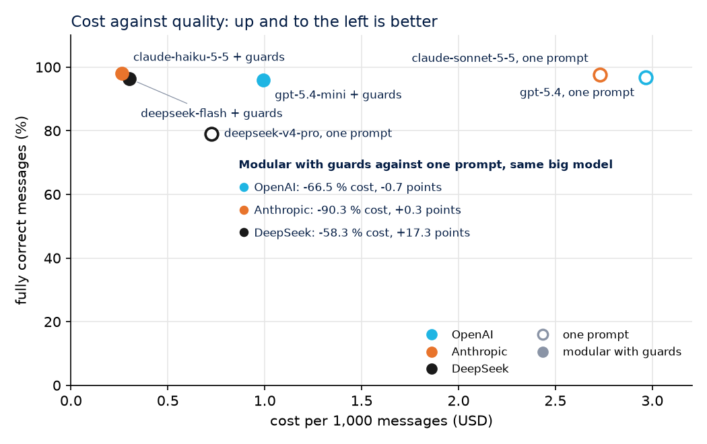

# llm-cost-quality-bench

**Medí cuánto cuesta un LLM y qué tan bien trabaja en una tarea de negocio real, antes de confiarle la tarea.**
Por [GlobalAIze](https://www.globalaize.com). Datos 100 % sintéticos. Corre sin API keys.

[](https://github.com/mauroemartinez/llm-cost-quality-bench/actions/workflows/ci.yml)
[](LICENSE)

[English version](README.md)

## El problema

Un agente de IA que contesta proveedores, lee cotizaciones o clasifica mensajes suele armarse una vez, con el modelo más grande disponible y un prompt largo, y queda corriendo. Dos cosas fallan en silencio:

- **Nadie sabe cuánto cuesta por tarea.** La factura llega por mes y por API key, no por mensaje. La caché de prompts, los reintentos y los tokens de razonamiento la vuelven difícil de leer.
- **Nadie sabe cada cuánto se equivoca.** "Se ve bien" no es un número. Cambiar a un modelo más barato es un salto al vacío, así que nadie lo hace.

Nosotros operamos agentes de IA para comercio internacional, donde cada mensaje a un proveedor importa. Antes de tocar producción necesitábamos responder con números: *qué costaría un modelo más barato o un diseño distinto, y qué rompería.*

## La solución

Este repositorio es ese método, abierto, sobre una tarea que cualquiera puede inspeccionar:

**La tarea.** Mensajes sintéticos de proveedores en una negociación de compras B2B: cotizaciones con precio, moneda, cantidad mínima, plazo de entrega, Incoterm y condiciones de pago, más respuestas a contraofertas, preguntas, rechazos y acuses de recibo. Cada mensaje viene con su respuesta correcta conocida. La IA tiene que **extraer** las condiciones, **clasificar** la intención y **redactar** nuestra respuesta. Los mensajes traen el ruido de los reales: un Incoterm alternativo ofrecido al lado del precio real, un precio corregido dentro del mismo mensaje, rangos, campos que faltan, errores de tipeo.

**Dos arquitecturas, mismos datos, mismos precios.**

| | A. Un agente, un prompt grande | B. Agentes modulares con controles de validación |
|---|---|---|
| Llamadas | una | reglas primero (un acuse de recibo nunca llega a un modelo), después clasificar, extraer y responder como etapas separadas |
| Modelo | el grande | el chico, con el grande de respaldo |
| Validación | se mide después | esquemas Pydantic y reglas de negocio en cada etapa; si falla, un reintento con la regla rota explicada, y después el modelo grande |

**Los controles son el punto.** "Copiá solo lo que escribió el proveedor" pasa a ser una regla que el código verifica: cada número que devuelve el modelo tiene que aparecer en el mensaje. "No aceptes un precio por encima de lo que pagamos" pasa a ser una regla. "Nunca reveles nuestro límite interno" pasa a ser una regla. Las reglas nunca ven la respuesta correcta, así que corren en producción igual que acá.

**Qué se mide, por llamada, en un libro JSONL:** proveedor, modelo, etapa, tokens de entrada, tokens de entrada en caché, tokens de salida, costo en USD al precio de lista de ese día, si el uso lo informó la API (exacto) o se estimó por largo de texto, latencia, si pasó la validación, qué reglas rompió, reintentos y respaldos.

**La calidad, en dos capas:**
1. **Automática**, contra la respuesta conocida: la intención, cada uno de los siete campos y si la respuesta cumple su función (contraoferta cuando corresponde, pide lo que falta, contesta la pregunta, cierra con cortesía, se calla ante un acuse).
2. **Manual**: una muestra aleatoria estratificada (por arquitectura y por intención) escrita en un CSV, revisada por una persona y puntuada con su intervalo de Wilson al 95 %. Los chequeos automáticos son baratos e incansables, y se equivocan de formas que una persona ve al instante; la planilla informa además cuántas veces el veredicto automático y el revisor no coincidieron.

**Más lo que hizo honestos a nuestros propios números:**
- una **tabla de precios con fecha y fuente para cada precio** (`prices.yaml`), leída de las páginas oficiales de los proveedores, con la entrada en caché a su propio precio;
- **exacto o estimado** marcado en cada fila;
- una **corrida de calibración**: el mismo modelo dos veces sobre los mismos mensajes. Cualquier diferencia entre dos configuraciones menor que esa brecha es ruido;
- **atípicos**: mensajes que cuestan más de dos veces la mediana, listados por id;
- una **proyección** a un volumen mensual;
- **modo offline**: cada respuesta grabada es un cassette en `fixtures/cassettes/`, así que cualquiera puede repetir el bench entero sin clave y sin gastar; las corridas en vivo tienen un tope de gasto.

## Resultados

Todo número que produce este repositorio sale de **datos sintéticos**. Nada de acá es un mensaje, un prompt ni un precio de producción.

**Corrida grabada, 30/10/2026: tres proveedores, 300 mensajes, uso de tokens informado por la API en cada llamada.** OpenAI con gpt-5.4 como modelo grande y gpt-5.4-mini como chico; Anthropic con claude-sonnet-5-5 y claude-haiku-5-5; DeepSeek con deepseek-v4-pro y deepseek-flash. Informe completo en [docs/report-2026-10-30.md](docs/report-2026-10-30.md) (en inglés). Se repite sin clave: `BENCH_MODE=offline bench all --pair openai --pair anthropic --pair deepseek --n 300`.

| Arquitectura | Totalmente correctos | Costo por 1.000 mensajes | Latencia p50 | Llamadas por mensaje |
|---|---|---|---|---|
| gpt-5.4, un prompt | 96,7 % | USD 2,97 | 2,0 s | 1,0 |
| gpt-5.4-mini con controles, gpt-5.4 de respaldo | 96,0 % | USD 0,99 | 3,2 s | 2,3 |
| claude-sonnet-5-5, un prompt | 97,7 % | USD 2,73 | 3,0 s | 1,0 |
| claude-haiku-5-5 con controles, claude-sonnet-5-5 de respaldo | 98,0 % | USD 0,26 | 3,6 s | 2,3 |
| deepseek-v4-pro, un prompt | 79,0 % | USD 0,72 | 1,8 s | 1,0 |
| deepseek-flash con controles, deepseek-v4-pro de respaldo | 96,3 % | USD 0,30 | 3,3 s | 2,25 |



<p align="center"><em>Misma calidad o mejor, por entre 58 % y 90 % menos: en los tres proveedores, un modelo chico con controles de validación iguala o supera al modelo grande con un solo prompt. Las diferencias de menos de un punto son dos o tres mensajes en 300.</em></p>

- **OpenAI.** El diseño modular cuesta **66,5 % menos** y queda 0,7 puntos por debajo del modelo grande: dos mensajes en 300. En la calibración (gpt-5.4 contra sí mismo sobre 30 mensajes) el modelo dio la misma respuesta 30 veces de 30.
- **Anthropic.** claude-haiku-5-5 con controles llega a **98,0 % a USD 0,26 por mil**, 90,3 % por debajo de claude-sonnet-5-5 con un prompt y 0,3 puntos por encima: el punto más barato y más preciso del gráfico. Su calibración también dio 30 de 30.
- **DeepSeek.** Con un solo prompt, deepseek-v4-pro escribe "above our target" en 57 de 300 respuestas, algo que la política prohíbe (le dice al proveedor que tenemos un techo), así que solo pasa el 79,0 % de sus mensajes. Con los controles, deepseek-flash llega a 96,3 % a USD 0,30 por mil, 58,3 % por debajo de su modelo grande. Calibración: 30 de 30.
- **Los controles se ganaron el lugar** en todos los modelos chicos. En gpt-5.4-mini atraparon 9 respuestas que revelaban nuestro límite y 5 que aceptaban en vez de contraofertar, arreglaron 15 mensajes con un reintento y mandaron 3 al modelo grande. En claude-haiku-5-5 atraparon 6 revelaciones del límite, 3 aceptaciones por encima de nuestro objetivo, 7 respuestas que no eran JSON válido y 2 respuestas demasiado largas, arreglaron 15 mensajes y mandaron 2 al modelo grande. deepseek-flash necesitó 2 reintentos y nunca el modelo grande.
- **Lo que cada uno sigue errando:** los modelos chicos leen mal la intención de algunos mensajes (gpt-5.4-mini 9 cotizaciones, deepseek-flash 11 cotizaciones, claude-haiku-5-5 1 cotización y 4 respuestas a contraofertas); gpt-5.4 se equivoca en un campo en 8 mensajes (un rango de plazo, una moneda al lado de un Incoterm alternativo); claude-sonnet-5-5 acepta un precio por encima de nuestro objetivo en 5 respuestas. Ninguno inventa un número: las reglas verifican cada cifra contra el mensaje.
- **El razonamiento de Claude.** claude-sonnet-5-5 y claude-haiku-5-5 razonan por defecto, y ese razonamiento oculto cuenta contra el tope de salida: encendido y con el mismo tope de 400 tokens, un tercio de sus respuestas llegó vacía o cortada. Esta corrida lo apaga (`disabled` en Haiku, `between_tools` en Sonnet, que tampoco aceptan `temperature`); el ajuste forma parte de la clave de cada cassette. Los otros proveedores corrieron con sus valores por defecto.
- **Puntaje justo.** Cuando un proveedor acepta "for 1000 rolls", eso es el tamaño de este pedido, no un mínimo: tanto la cantidad mínima vacía como 1000 cuentan como correctas.
- **Caché y horario.** La caché de prompts sirvió el 80 % de los tokens de entrada de claude-sonnet-5-5 y el 72 % de los de deepseek-v4-pro, cada uno a su precio de caché en el libro. DeepSeek además cobra la mitad en horario reducido (16:30 a 00:30 UTC), que el libro no aplica, así que su factura real queda por debajo del costo de lista que se muestra.
- **Lo que costaron las grabaciones** a precio de lista: OpenAI USD 1,19 más USD 0,18 de calibración; Anthropic USD 0,90 más USD 0,17, después de un primer intento con el razonamiento encendido que se descartó; DeepSeek USD 0,31 más USD 0,03.

Las corridas simuladas (el proveedor mock, sin ningún modelo detrás) siguen corriendo en la integración continua en cada push y publican su informe como artefacto; esos gráficos solo muestran la forma de la salida, no el rendimiento de ningún modelo.

En nuestro propio trabajo de producción usamos este mismo procedimiento antes de un cambio de modelo: repetimos 262 turnos reales de negociación en un sandbox sin enviar nada, los juzgamos contra el modelo actual con reglas más un juez y revisamos a mano los desacuerdos. La configuración más barata, lograda optimizando el uso de los modelos, costó 87 % menos por llamada con la misma calidad (alrededor de 95 % de coincidencia con el modelo actual en la revisión manual), un ahorro de 96 % proyectado al volumen de ese mes. Esos números salen de esa medición documentada, no de este repositorio; acá todo es sintético.

## Stack

Python 3.11+, Pydantic v2 (esquemas), Polars (agregación), Matplotlib (gráficos), httpx (cuatro proveedores detrás de una misma interfaz: OpenAI, Anthropic, Gemini, DeepSeek), PyYAML (precios), pytest y ruff, GitHub Actions (corrida offline en cada push).

## Cómo correrlo

```bash
git clone https://github.com/mauroemartinez/llm-cost-quality-bench
cd llm-cost-quality-bench
python -m venv .venv && source .venv/bin/activate   # Windows: .venv\Scripts\activate
pip install -e ".[dev]"

# Todo offline, sin claves: genera los casos, corre las dos arquitecturas sobre el
# proveedor simulado, puntúa, escribe la planilla de revisión y el informe con gráficos.
bench all --pair mock
```

Las salidas quedan en `results/<run-id>/`: `ledger.jsonl` (una línea por llamada), `results.jsonl` (una por mensaje), `report.md` con `img/`, y `review/<run-id>.csv` para completar a mano.

Con modelos reales:

```bash
cp .env.example .env            # cargá solo las claves que quieras usar
bench all --pair openai --pair anthropic --n 50 --max-usd 2   # graba cassettes mientras corre
bench calibrate --provider openai --n 30                       # el piso de ruido
bench review --compute review/<run-id>.csv                     # después de completar reviewer_verdict
bench report --run results/<run-id> --review-sheet review/<run-id>.csv
```

- `--pair` elige un par de modelos grande/chico por proveedor (los valores por defecto están en `bench/cli.py`); `--big` y `--small` aceptan cualquier modelo de `prices.yaml`.
- Con una clave presente, el modo por defecto es `record`: cada respuesta se guarda en `fixtures/cassettes/` y la corrida siguiente la repite gratis. `BENCH_MODE=offline` prohíbe cualquier llamada en vivo.
- `--max-usd` frena la corrida cuando el gasto en vivo supera el tope (USD 2 por defecto). Las repeticiones no cuentan.
- `bench generate --n 1000 --seed 11` arma un conjunto de datos más grande o distinto.

Tests: `pytest`. Lint: `ruff check .`.

## Estructura

```
bench/
  synth.py        mensajes sintéticos y sus respuestas correctas (con semilla)
  schemas.py      contratos Pydantic: Quote, Intent, Case, CallRecord
  rules.py        reglas de negocio: los controles de validación (sin ver la verdad)
  prompts.py      prompts escritos para este benchmark, una tarea por etapa
  providers/      una interfaz, cuatro adaptadores HTTP, un grabador de cassettes, un simulado
  archs/          el agente de un solo prompt y el pipeline modular con controles
  pricing.py      prices.yaml y el costo de una llamada (la caché a su precio)
  meter.py        el libro JSONL y el tope de gasto
  score.py        puntuación automática y agregados
  review.py       muestra estratificada, planilla CSV, intervalo de Wilson
  report.py       informe Markdown y gráficos (costo, precisión, latencia, Pareto)
  cli.py          generate | run | score | review | report | calibrate | all
prices.yaml       USD por millón de tokens, con la fecha y la página fuente
fixtures/         cases.jsonl y los cassettes grabados
tests/            pytest, todo offline
```

## Licencia

Apache 2.0. Ver [LICENSE](LICENSE).

---

¿Querés esta auditoría sobre tu stack de IA? [www.globalaize.com](https://www.globalaize.com)
