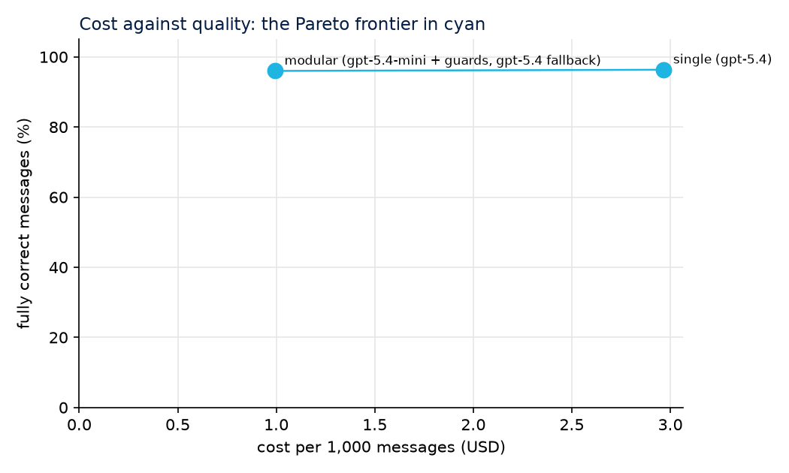

# llm-cost-quality-bench

**Measure what an LLM costs and how well it works on a real business task, before you trust it with the task.**
By [GlobalAIze](https://www.globalaize.com). 100 % synthetic data. Runs with no API keys.

[](https://github.com/mauroemartinez/llm-cost-quality-bench/actions/workflows/ci.yml)
[](LICENSE)

[Versión en español](README.es.md)

## The problem

An AI agent that answers suppliers, reads quotes or classifies messages is usually built once, with the biggest model available and one long prompt, and then left running. Two things go wrong quietly:

- **Nobody knows what it costs per task.** Invoices arrive per month and per API key, not per message. Prompt caching, retries and reasoning tokens make the bill hard to read.
- **Nobody knows how often it is wrong.** "It looks fine" is not a number. Changing the model to a cheaper one is a leap in the dark, so nobody does it.

We run AI agents for international trade operations, where every message to a supplier matters. Before changing anything in production we needed a way to answer, with numbers: *what would a cheaper model or a different design cost, and what would it break?*

## The solution

This repository is that method, in the open, on a task anyone can inspect:

**The task.** Synthetic messages from suppliers in a B2B purchasing negotiation: quotes with a price, currency, minimum order, lead time, Incoterm and payment terms, plus counter-offer replies, questions, declines and plain acknowledgements. Every message comes with its known correct answer. The AI has to **extract** the terms, **classify** the intent and **draft** our reply. The messages carry the noise real ones have: an alternative Incoterm offered next to the real price, a price revised inside the same message, ranges, missing fields, typos.

**Two architectures, same data, same prices.**

| | A. One agent, one big prompt | B. Modular agents with validation guards |
|---|---|---|
| Calls | one | rules first (plain acknowledgements never reach a model), then classify, extract and reply as separate stages |
| Model | the big one | the small one, with the big one as fallback |
| Validation | measured afterwards | Pydantic schemas and business rules on every stage; on failure, one retry with the broken rule spelled out, then the big model |

**The guards are the point.** "Copy only what the supplier wrote" becomes a rule the code can check: every number the model returns has to appear in the message. "Do not accept a price above what we pay" becomes a rule. "Never reveal our internal limit" becomes a rule. The rules never see the correct answer, so they run in production exactly as they run here.

**What gets measured, per call, in a JSONL ledger:** provider, model, stage, input tokens, cached input tokens, output tokens, cost in USD at that day's list price, whether the usage was reported by the API (exact) or estimated from text length, latency, whether validation passed, which rules it broke, retries and fallbacks.

**Quality, in two layers:**
1. **Automatic**, against the known answer: intent, each of the seven fields, and whether the reply does its job (counters when it should, asks for what is missing, answers the question, closes politely, stays silent on an acknowledgement).
2. **Manual**: a stratified random sample (by architecture and by intent) written to a CSV, reviewed by a person, and scored with its 95 % Wilson interval. Automatic checks are cheap and tireless, and wrong in ways a person spots at once; the sheet also reports how often the automatic verdict and the reviewer disagreed.

**Plus the things that made our own numbers honest:**
- a **price table with a date and a source for every price** (`prices.yaml`), read from the providers' official pages, with cached input at its own price;
- **exact or estimated** marked on every row;
- a **calibration run**: the same model twice on the same messages. Any difference between two configurations smaller than that gap is noise;
- **outliers**: messages costing more than twice the median, listed by id;
- a **projection** to a monthly volume;
- **offline mode**: every recorded response is a cassette in `fixtures/cassettes/`, so anyone can rerun the whole bench with no key and no spend; live runs have a hard budget cap.

## Results

Every number this repository produces comes from **synthetic data**. Nothing here is a production message, prompt or price.

**Recorded run, 2026-10-29: OpenAI, gpt-5.4 as the big model and gpt-5.4-mini as the small one, 300 messages, usage reported by the API on every call.** Full report in [docs/report-openai-2026-10-29.md](docs/report-openai-2026-10-29.md). Replay it with no key: `BENCH_MODE=offline bench all --pair openai --n 300`.

| Architecture | Fully correct | Cost per 1,000 messages | Latency p50 | Calls per message |
|---|---|---|---|---|
| A. One agent, one big prompt (gpt-5.4) | 96.3 % | USD 2.97 | 2.0 s | 1.0 |
| B. Modular: gpt-5.4-mini with guards, gpt-5.4 as fallback | 96.0 % | USD 0.99 | 3.2 s | 2.3 |



- The modular design costs **67 % less** at the same quality: the 0.3-point gap is one message in 300. On the calibration run (gpt-5.4 against itself on 30 messages) the model gave the same answer 30 times out of 30, so this sample cannot tell the two apart on quality.
- The guards earned their keep on the small model: they caught 9 replies that leaked our internal limit and 5 that accepted instead of countering, fixed 15 messages with one retry, and sent only 3 of 300 messages to the big model.
- What each one still gets wrong: the small model reads 9 of 125 plain quotes as another intent; the big model misreads one field in 9 messages (a lead-time range, a currency next to an alternative Incoterm). Neither invents a number: the rules check every figure against the message.
- The recording cost USD 1.19 at list price (USD 0.89 for the big model, USD 0.30 for the small one), plus USD 0.18 for the calibration.

Simulated runs (the mock provider, no model behind it) still run in CI on every push and publish their report as an artifact; those charts only show the shape of the output, not how any model performs.

In our own production work we used this same procedure before a model change: we replayed 262 real negotiation turns in a sandbox without sending anything, judged them against the current model with rules plus a judge, and reviewed the disagreements by hand. The cheaper configuration, reached by optimising how the models are used, cost 87 % less per call at the same quality (about 95 % agreement with the current model on manual review), a 96 % saving when projected to that month's volume. Those numbers come from that documented measurement, not from this repository; everything here is synthetic.

## Stack

Python 3.11+, Pydantic v2 (schemas), Polars (aggregation), Matplotlib (charts), httpx (four providers behind one interface: OpenAI, Anthropic, Gemini, DeepSeek), PyYAML (prices), pytest and ruff, GitHub Actions (offline run on every push).

## How to run

```bash
git clone https://github.com/mauroemartinez/llm-cost-quality-bench
cd llm-cost-quality-bench
python -m venv .venv && source .venv/bin/activate   # Windows: .venv\Scripts\activate
pip install -e ".[dev]"

# Everything offline, no keys: generate the cases, run both architectures on the
# simulated provider, score, write the review sheet and the report with charts.
bench all --pair mock
```

Outputs land in `results/<run-id>/`: `ledger.jsonl` (one line per call), `results.jsonl` (one per message), `report.md` with `img/`, and `review/<run-id>.csv` to fill in by hand.

With real models:

```bash
cp .env.example .env            # add only the keys you want to use
bench all --pair openai --pair anthropic --n 50 --max-usd 2   # records cassettes as it goes
bench calibrate --provider openai --n 30                       # the noise floor
bench review --compute review/<run-id>.csv                     # after filling reviewer_verdict
bench report --run results/<run-id> --review-sheet review/<run-id>.csv
```

- `--pair` picks a big/small model pair per provider (defaults in `bench/cli.py`); `--big` and `--small` take any model in `prices.yaml`.
- With a key present, the default mode is `record`: every response is saved under `fixtures/cassettes/` and the next run replays it for free. `BENCH_MODE=offline` forbids any live call.
- `--max-usd` stops the run when live spend crosses the cap (default USD 2). Replays never count.
- `bench generate --n 1000 --seed 11` makes a bigger or different data set.

Tests: `pytest`. Lint: `ruff check .`.

## Layout

```
bench/
  synth.py        synthetic messages and their correct answers (seeded)
  schemas.py      Pydantic contracts: Quote, Intent, Case, CallRecord
  rules.py        business rules: the validation guards (truth-free)
  prompts.py      prompts written for this benchmark, one task per stage
  providers/      one interface, four HTTP adapters, a cassette recorder, a mock
  archs/          single-prompt agent and the modular pipeline with guards
  pricing.py      prices.yaml and the cost of a call (cache priced apart)
  meter.py        the JSONL ledger and the budget cap
  score.py        automatic scoring and aggregates
  review.py       stratified sample, CSV sheet, Wilson interval
  report.py       Markdown report and charts (cost, accuracy, latency, Pareto)
  cli.py          generate | run | score | review | report | calibrate | all
prices.yaml       USD per 1M tokens, with the date and the source page
fixtures/         cases.jsonl and the recorded cassettes
tests/            pytest, all offline
```

## License

Apache 2.0. See [LICENSE](LICENSE).

---

Want this audit on your AI stack? [www.globalaize.com](https://www.globalaize.com)
