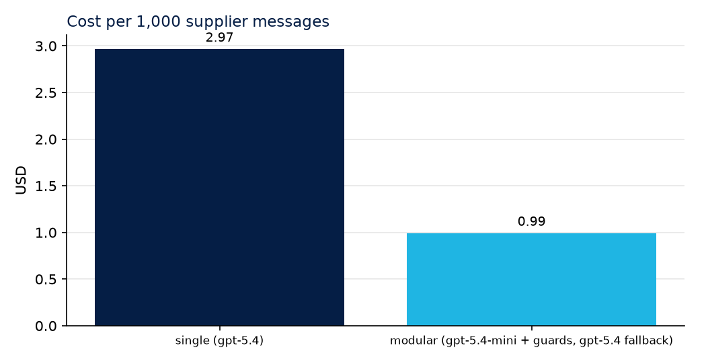
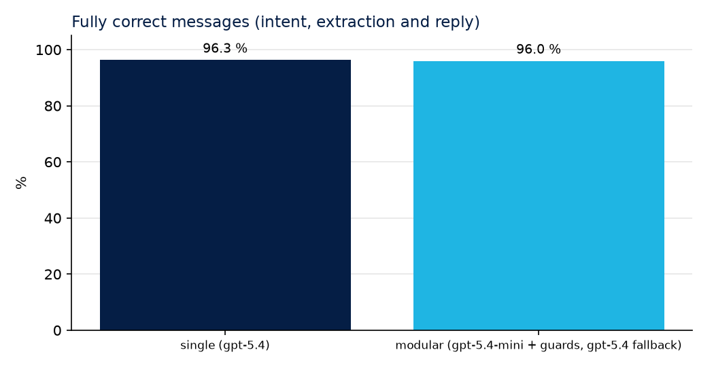
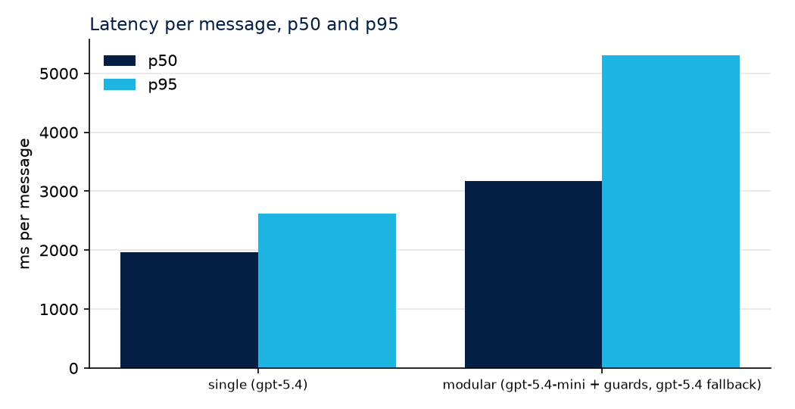

# Cost and quality report: openai-2026-10-29

Synthetic data: 300 supplier messages generated with seed 7; nothing here comes from a real supplier, customer or production system. Prices as read on 2026-10-29 (see prices.yaml for the sources).

## Architectures

- **single (gpt-5.4)**: one agent, one big prompt, gpt-5.4, no retries
- **modular (gpt-5.4-mini + guards, gpt-5.4 fallback)**: rules first, then classify, extract and reply as separate stages on gpt-5.4-mini; validation guards retry once with a correction and fall back to gpt-5.4

## Summary

| Architecture | Messages | Fully correct | Intent | Extraction (all 7 fields) | Fields | Reply does its job | Cost per 1,000 | Median per message | Latency p50 (ms) | Latency p95 (ms) |
|---|---|---|---|---|---|---|---|---|---|---|
| single (gpt-5.4) | 300 | 96.3 % | 100.0 % | 97.0 % | 99.5 % | 99.3 % | USD 2.97 | USD 0.0030 | 1,970 | 2,621 |
| modular (gpt-5.4-mini + guards, gpt-5.4 fallback) | 300 | 96.0 % | 97.0 % | 99.0 % | 99.9 % | 97.7 % | USD 0.99 | USD 0.0011 | 3,172 | 5,306 |

## Cost against quality

On the frontier (nothing is both cheaper and better): **modular (gpt-5.4-mini + guards, gpt-5.4 fallback)**, **single (gpt-5.4)**.

## Guards: validation, retries and fallbacks

| Architecture | Calls per message | First attempts that failed validation | Messages retried | Messages sent to the big model | Unparsable answers | Input served from cache | Calls priced by estimate |
|---|---|---|---|---|---|---|---|
| single (gpt-5.4) | 1.00 | 6 | 0 | 0 | 0 | 0.0 % | 0.0 % |
| modular (gpt-5.4-mini + guards, gpt-5.4 fallback) | 2.30 | 15 | 15 | 3 | 0 | 0.0 % | 0.0 % |

Violations caught by the rules, by type (every attempt counted):

- **single (gpt-5.4)**: did_not_answer_port (4), did_not_answer_logo (1), missing_counter_offer (1)
- **modular (gpt-5.4-mini + guards, gpt-5.4 fallback)**: leaked_internal_data (9), missing_counter_offer (5), did_not_answer_logo (3), did_not_answer_port (1)

## By intent

| Architecture | Intent | Messages | Fully correct | Mean cost |
|---|---|---|---|---|
| modular (gpt-5.4-mini + guards, gpt-5.4 fallback) | acknowledgement | 55 | 100.0 % | USD 0.0000 |
| modular (gpt-5.4-mini + guards, gpt-5.4 fallback) | counter_reply | 57 | 100.0 % | USD 0.0011 |
| modular (gpt-5.4-mini + guards, gpt-5.4 fallback) | decline | 27 | 100.0 % | USD 0.0006 |
| modular (gpt-5.4-mini + guards, gpt-5.4 fallback) | question | 36 | 100.0 % | USD 0.0007 |
| modular (gpt-5.4-mini + guards, gpt-5.4 fallback) | quote | 125 | 90.4 % | USD 0.0015 |
| single (gpt-5.4) | acknowledgement | 55 | 100.0 % | USD 0.0025 |
| single (gpt-5.4) | counter_reply | 57 | 96.5 % | USD 0.0030 |
| single (gpt-5.4) | decline | 27 | 100.0 % | USD 0.0028 |
| single (gpt-5.4) | question | 36 | 97.2 % | USD 0.0029 |
| single (gpt-5.4) | quote | 125 | 93.6 % | USD 0.0032 |

## Outliers

- **single (gpt-5.4)**: median USD 0.0030 per message; 0 messages above twice the median.
- **modular (gpt-5.4-mini + guards, gpt-5.4 fallback)**: median USD 0.0011 per message; 3 messages above twice the median: case-0018 (USD 0.0026), case-0197 (USD 0.0046), case-0221 (USD 0.0043).

## Projection

At 5,000 supplier messages per month:

- **single (gpt-5.4)**: USD 14.83 per month
- **modular (gpt-5.4-mini + guards, gpt-5.4 fallback)**: USD 4.97 per month

## How to read this

- *Fully correct* needs the intent, all seven quote fields and a reply that does its job, all at once.
- Costs use the list price of each model on the date in prices.yaml, with cached input at its own price.
- *Calls priced by estimate* are calls whose API gave no usage; their tokens were estimated from text length.
- Every call is one line in `ledger.jsonl`; every message, one line in `results.jsonl`. Regroup them as you need.
